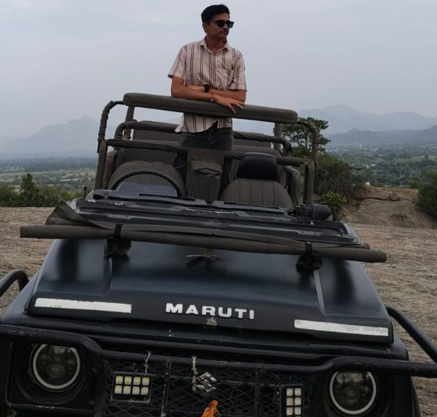

<h1 align="center">Darshil Ajudia | Personal Portfolio</h1>

	

	A modern, responsive portfolio highlighting my background, skills, projects, and experience as a Computer Science student and full-stack web developer.

	<a href="https://darshilajudia-portfolio.infinityfree.me/">View Portfolio</a> ·
	<a href="mailto:darshilajudia.7@gmail.com">Email Me</a>

## About

Welcome to my portfolio. I am **Darshil Ajudia**, a Computer Science student and full-stack web developer based in Rajkot, Gujarat, India. I enjoy building responsive, accessible, and practical web experiences with thoughtful design and reliable functionality.

## What You'll Find

- An introduction and overview of my education and experience
- A summary of my technical skills
- Selected projects with category filters and links to source code or live demos
- A contact form for project, internship, and career inquiries
- Links to my resume and professional profiles

## Technology

- **Frontend:** HTML5, CSS3, JavaScript, Bootstrap 5.3
- **Backend:** PHP
- **Database:** MySQL
- **UI resources:** Boxicons and Google Fonts

The contact form uses PHP and MySQL. Bootstrap, Boxicons, and Google Fonts are loaded from external CDNs, so an internet connection is required for those resources.

## Contact & Social Links

- **Email:** [darshilajudia.7@gmail.com](mailto:darshilajudia.7@gmail.com)
- **Portfolio:** [Darshil Ajudia](https://darshilajudia-portfolio.infinityfree.me/)
- **GitHub:** [darshilajudia7](https://github.com/darshilajudia7)
- **LinkedIn:** [Darshil Ajudia](https://www.linkedin.com/in/darshil-ajudia-62331232b/)
